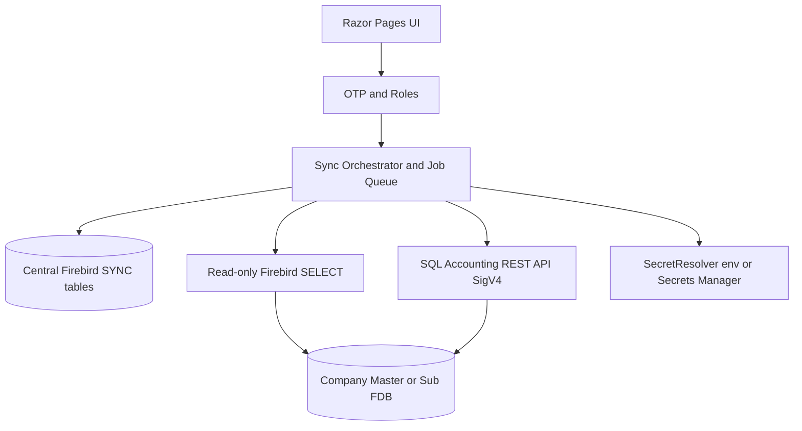

# SQL Account Sync

Orchestration layer for Master and Sub SQL Accounting Firebird databases: mapping, jobs, and API-backed writes.

## Overview

SQL Account Sync (GitHub repository name `multiDBSync`) is an ASP.NET Core 8 Razor Pages control plane. It does not copy SQL Accounting. Company `.FDB` files stay the source of accounting data. The central Firebird database holds `SYNC_*` control tables. Reads against company files use read-only Firebird transactions; writes go through the official SQL Accounting REST API (SigV4), never raw INSERT into company databases.

It is intended for operators who need to keep master and sub company books aligned under explicit mappings and job control.

## Key Features

- Bootstrap admin OTP sign-in (`Bootstrap:AdminEmail`)
- Roles: ADMIN, MANAGER, OPERATOR, VIEWER
- Database registry (master/sub connections)
- Relationship and mapping screens
- Job queue and transaction history
- Browse / test connection against company files (opt-in)
- Audit and error logs
- Secret references (`env:` / Secrets Manager) instead of plaintext passwords in config
- Dry-run path with no write adapter to the API
- `SqlGuard` allows only SELECT/WITH against company databases

## Architecture



## Tech Stack

- C# / ASP.NET Core 8 (`net8.0-windows`)
- Firebird 10.3.4 client
- MailKit, DotNetEnv, AWS Secrets Manager
- xUnit test project `tests/SqlAccountSync.Tests`

## Setup

```powershell
copy src\SqlAccountSync\.env.example src\SqlAccountSync\.env
# Set CENTRAL_FB_PASSWORD and CentralDb path to an empty central Firebird database
dotnet run --project src\SqlAccountSync --launch-profile http
```

Sign in with `Bootstrap:AdminEmail` (default `admin@localhost`). In Development, OTP is written to the console when SMTP is not configured.

Do not set `ApiCredRef` or `Sync:AllowProductionConnections` until backup/recovery in [`docs/BACKUP_AND_RECOVERY.md`](docs/BACKUP_AND_RECOVERY.md) is complete.

## Testing

```powershell
dotnet test tests\SqlAccountSync.Tests\SqlAccountSync.Tests.csproj
```

Automated tests use fakes and do not touch a company database.

## Security

- Company writes are API-only; `SqlGuard` blocks non-SELECT SQL.
- Passwords use `PasswordSecretRef` (for example `env:CENTRAL_FB_PASSWORD`).
- See [`docs/ENTERPRISE.md`](docs/ENTERPRISE.md) and [`docs/OPERATIONS.md`](docs/OPERATIONS.md).

## License

[ADD INFORMATION]
