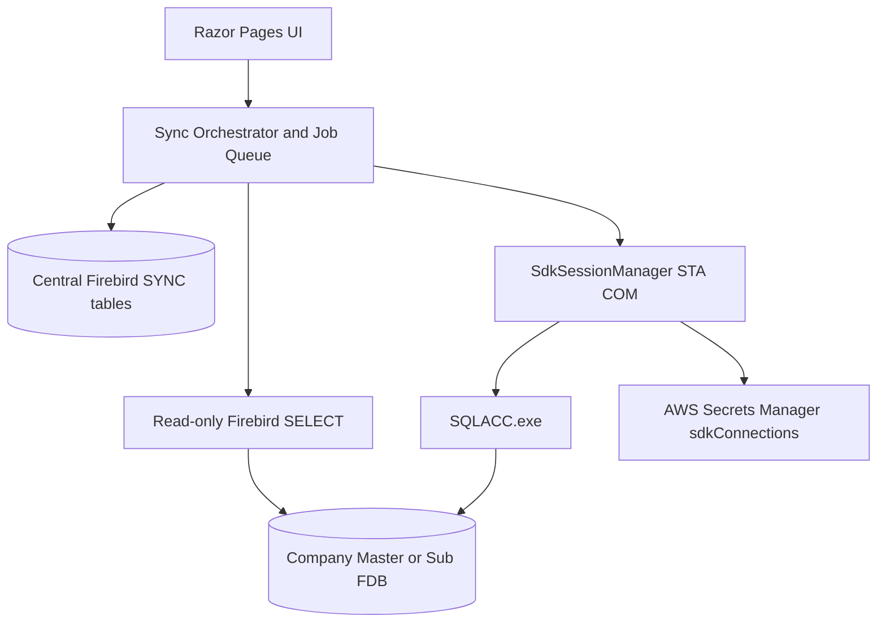

# SQL Account Sync (SDK Live)

Orchestration layer for Master and Sub SQL Accounting Firebird databases: mapping, jobs, and **SQL Account SDK Live (COM)** writes.

Branch `sdk-conversion` replaces the former HTTP SigV4 SQL Accounting API with local `SQLAcc.BizApp`. Rollback tag: `before-sdk-conversion`.

## Overview

ASP.NET Core 8 Razor Pages control plane. Company `.FDB` files stay the source of accounting data. The central Firebird database holds `SYNC_*` control tables.

- **Reads** against company files: read-only Firebird transactions (`FirebirdReadAdapter`)
- **Writes**: SQL Account SDK Live via `SdkWriteAdapter` / `SdkSessionManager` (one STA thread, one company login at a time)
- **SDK credentials**: one AWS Secrets Manager secret per tenant — `proacc/tenant/{TENANT_CODE}/sdkConnections`

## Architecture



## Setup (dev)

```powershell
copy src\SqlAccountSync\.env.example src\SqlAccountSync\.env
# TENANT_CODE, AWS_*, optional SDK_SECRET_ID, CentralDb path
dotnet run --project src\SqlAccountSync --launch-profile http
```

SDK smoke / discover (requires SQL Account installed + secret with UAMAT row):

```powershell
dotnet run --project src\SqlAccountSync -- --sdk-smoke --db=UAMAT
dotnet run --project src\SqlAccountSync -- --sdk-discover --db=UAMAT
```

## Deploy (SDK)

Use [`DeployCommands/SqlAccountSync-SDK/deploy-SqlAccountSync-SDK-github.cmd`](../DeployCommands/SqlAccountSync-SDK/deploy-SqlAccountSync-SDK-github.cmd):

- Auto UAC elevation
- Publishes branch `sdk-conversion`
- Disables the old Windows **service**
- Registers scheduled task **SqlAccountSync-SDK** (At log on, highest privileges)

See `BEFORE_SDK_CHECKPOINT.txt` and `docs/SDK_SETUP.md` for Secrets Manager / DynamoDB checklist.

## Testing

```powershell
dotnet test tests\SqlAccountSync.Tests\SqlAccountSync.Tests.csproj
```

## License

[ADD INFORMATION]
