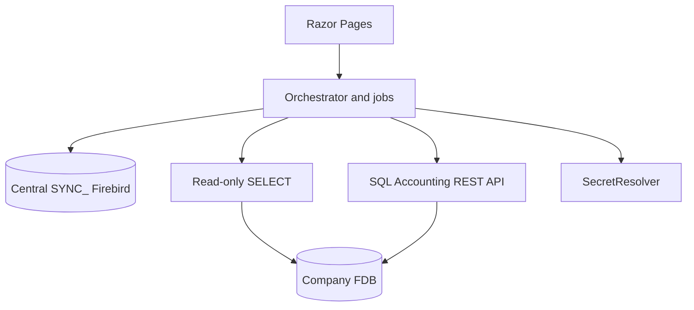

# Architecture

Control plane only. Company Firebird files stay the source of accounting data. Central Firebird holds `SYNC_*` tables. Reads use read-only transactions; `SqlGuard` allows SELECT/WITH only. Writes go through the SQL Accounting REST API (SigV4).

Pages: Databases, Relationships, Mappings, Jobs, Transactions, Browse, Users, Settings, Audit, Errors, Logs.

Details: [ENTERPRISE.md](ENTERPRISE.md), [OPERATIONS.md](OPERATIONS.md), [BACKUP_AND_RECOVERY.md](BACKUP_AND_RECOVERY.md).
